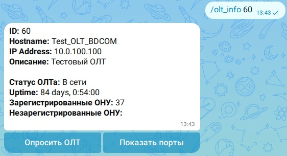
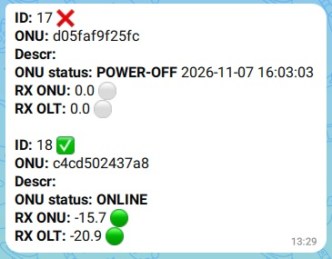

## OLTsHUB MAX BOT

  

##  v1.0
MAX бот для просмотра состояния абонентских оптических терминалов, фирмы Huawei и BDCOM.
Бот не является автономным приложением, в качестве бэкенда используется [OLTsHUB](https://github.com/drag0y/olts_hub) версии 3.8 и выше.  
Бот работает в режиме поллинга. Ему не нужен "белый ip".

Пример работы бота:

  

  

#### [Инструкция по установке](docs/install.md)
#### [Инструкция пользователя](docs/user_guide.md)

#### По любым вопросам можно писать на oltshub@gmail.com
