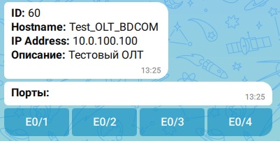

## Установка
Клонировать репозиторий или скачать архив в любую удобную директорию.
Перейти в папку с приложением если ещё не там.
Создаём виртуальное окружение:
```commandline
python3 -m venv .venv
```
Где __.venv__ это директория, где и будет наше виртуальное окружение (она создастся при выполнении команды).
Для перехода в виртуальное окружение надо выполнить команду:
```commandline
source .venv/bin/activate
```
После успешной активации виртуального окружения, в командной строке рядом с именем пользователя будет надпись __(.venv)__.

Установить необходимые модули из файла requirements.txt.
```commandline
pip install -r requirements.txt
```

Далее переименовать файл-шаблон конфигурации __env_template.py__ в __.env__.
```commandline
mv env_template.py .env
```
Заполнить данные для работы.

```
# Токен бота МАКС
MAX_TOKEN=11223344556677889900
# Количество столбцов с кнопками
BUTTON_COL=4
# Ссылка на OLTsHUB
OLTSHUB_URL=http://127.0.0.1:5000
```

Количество столбцов с кнопками влияют на вывод портов в сообщении, на данный момент Макс поддерживает до 7 столбцов. По дефолту стоит 4 столбца.

<div align="center">
  
</div>

Бот работает в режиме поллинга. Ему не нужен "белый ip".  

После чего можно запускать приложение.

```commandline
python3 app.py
```

Дальнейшая работа с ботом описана в [инструкции пользователя](user_guide.md)