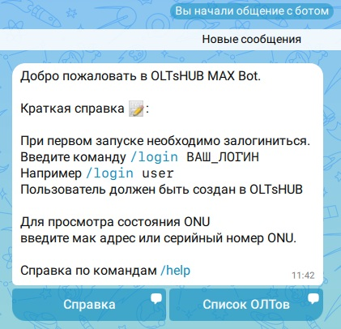
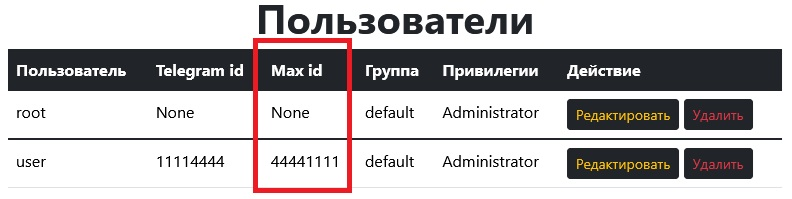
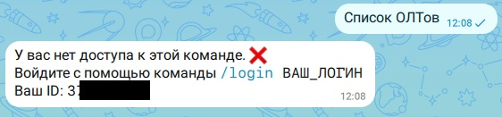
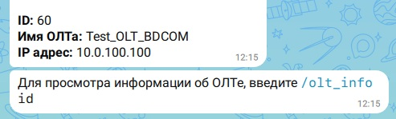
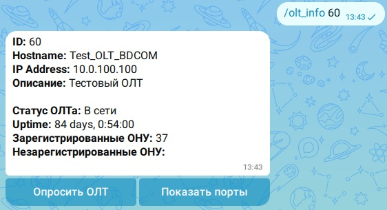
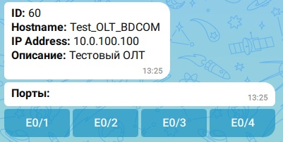
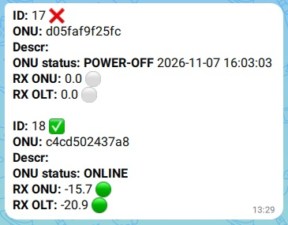
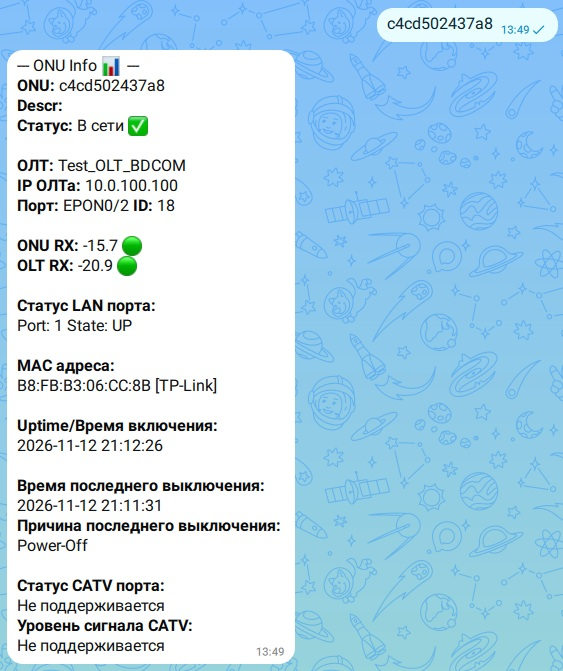

<h1 align="center">Добро пожаловать в OLTsHUB MAX BOT</h1>

Этот инструмент предназначен для получения актуальной информации о оптических терминалах (ONU/ONT).

При первом входе в бота нажимаете кнопку "__Начать__", и первым сообщением появится краткая справка.

  

  

Нажав "__Справка__" можно получить более развёрнутую информаци о командах.

Вызвать справку можно командой __/help__ или написав словами "__справка__", вызвать снова стартовое сообщение можно командой __/start__

Нажав на "__Список ОЛТов__" можно посмотреть все ОЛТы доступные для опроса. Но при первом входе бот выдаст ошибку, т.к. нужно сначала залогиниться.

Для этого введите команду __/login user__, где user - это Ваш логин в OLTsHUB.  

  

Вход в приложение осуществляется по связке Логин + MAX ID, оба этих параметра хранятся в OLTsHUB в соответствующих полях.

  

После этого кнопка просмотра ОЛТов будет работать.

Узнать свой ID можно введя любую команду требующую входа или просто какой нибудь текст.

  

Для того что бы вызвать список ОЛТов из чата, введите команду __/olts_list__ или "__список олтов__", или в стартовом меню нажмите кнопку "__Список ОЛТов__".  

Что бы посмотреть информацию о конкретном ОЛТе, введите команду __/olt_info id__, где id это идентификатор ОЛТа, его можно увидеть в списке ОЛТов.

  

В информации об ОЛТе можно опросить ОЛТ и посмотреть список PON портов.

  

Кнопка "__Опросить ОЛТ__", запустит на OLTsHUB процесс опроса ОЛТа, после чего информация в базе о зарегистрированных ОНУ обновится.  

При просмотре списка портов, можно нажать на конкретный порт, после чего начнётся опрос ОНУ со всего PON дерева. 

  

Здесь, в зависисмости от скорости ОЛТа, необходимо подождать пока произойдёт опрос всего порта. Какие то ОЛТы могут отдавать информацию 3 минуты, какие то за 5 секунд.

  

Статус порта будет состоять из списка зарегистрированных на порту ОНУ, и их состоянием.

Галочка напротив ID означает, что ОНУ в сети, а крестик, что ону не в сети. Далее идёт мак адрес или серийный номер. За ним Descr (описание) ОНУ.

ONU status имеет несколько состояний, если ОНУ в сети, то это ONLINE. Если ОНУ не в сети, то тут пишется причина, это может быть Power-Off (отсутствие питания), LOS (нет оптического сигнала), или неизвестно, это либо неизвестный код отключения ОНУ, либо ОЛТ перезагружался, и информация на ОЛТе утеряна.  Если ОНУ не в сети, то так же указана дата и время когда ОНУ пропала из сети.

Далее идут уровни сигналов.

Для просмотра информации или поиска конкретной ОНУ, необходимо ввести её мак адрес или серийный номер без каких либо команд. Поддерживается любой формат, например aabbccddeeff, aabb-ccdd-eeff, aa:bb:cc:dd:ee:ff. Бот реагирует на любой текст, как на мак адрес или серийник, если этот текст не является командой.  
Например так можно посмотреть информацию об ОНУ:

  

